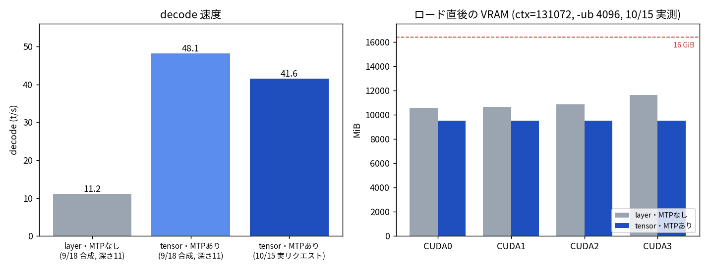

# t120h-p100 に Qwen3.8-27B の tensor 分割 + MTP プリセットを追加

- **実施日時**: 2026年10月15日 〜 10月17日 JST (t120h-p100 の電源投入と Qwen3.8-27B の起動、tensor 分割 + MTP での再起動と動作確認、シャットダウン、`start.sh` へのプロファイル追加とスタブ検証)
- **報告日時**: 2026年10月17日 17:56 JST
- **作成者**: Claude Opus 5.5 (1M context)

## 概要

ユーザから t120h-p100 で Qwen3.8 の 27B モデルを起動するよう依頼を受けた。サーバは電源が切れていたので iLO から投入し、ロックを取ってから起動した。モデルは以前の計測で使ったものがサーバ上に置いてあったため、ダウンロードは要らなかった。

最初の起動は、起動スクリプトの既定どおりの「層ごとに分ける方式」で、モデルに同梱されている先読み機構（MTP）も使わない構成だった。ユーザから両方を有効にしているか確認があり、どちらも無効だったため、「一つの層を全カードで分担する方式（tensor 分割）」と MTP を有効にして再起動した。この組み合わせは 9 月 18 日の計測で、同じサーバ・同じモデル・同じ llama.cpp で動くことを確認済みだった。

再起動後は 4 枚のカードのメモリ使用量が完全に揃い、MTP の読み込みもログで確認できた。短い実リクエストで生成速度を測ると毎秒 41.6 トークンで、層ごとに分ける方式・MTP なしでの過去の実測の約 3.7 倍だった。aws-gpu01 で問題になった起動時のハングは出なかった。

作業の途中で、起動スクリプトのサンプリング設定の分岐が Qwen3.5 と 3.6 しか見ておらず、Qwen3.8 には汎用の設定が使われてしまう不備が見つかったので直した。

ユーザの希望により、この構成を t120h-p100 のプリセットとして起動スクリプトに組み込んだ。モデル名に Qwen3.8-27B を含み、かつサーバが t120h-p100 のときだけ、自動で tensor 分割と MTP を有効にする。ほかのサーバでは従来どおりの構成になる。あわせて、サーバの `~/models` に手で置いたモデルを HF の名前で指定できるようにした。これがないと、p100 上で HF から直接ダウンロードしに行ってしまうためである。

サーバは使用後にシャットダウンしたため、組み込んだプリセットは実機ではまだ起動していない。起動コマンドが正しく組み立てられることは、通信部分を偽物に差し替えたスクリプトで確認した。次に実機で起動するときに、プリセット経由でも同じ構成で立つことを一度確かめる必要がある。

## 添付ファイル

- [比較図](attachment/2026-10-17_175608_t120h_p100_qwen38_27b_tensor_mtp_preset/summary.png) ／ [作図スクリプト](attachment/2026-10-17_175608_t120h_p100_qwen38_27b_tensor_mtp_preset/plot_summary.py)
- [実リクエストの timings と VRAM 実測値](attachment/2026-10-17_175608_t120h_p100_qwen38_27b_tensor_mtp_preset/generation-timings.json)
- [start.sh のスタブ検証スクリプト](attachment/2026-10-17_175608_t120h_p100_qwen38_27b_tensor_mtp_preset/verify-start-sh.sh) ／ [ssh スタブ](attachment/2026-10-17_175608_t120h_p100_qwen38_27b_tensor_mtp_preset/fake-ssh.sh) ／ [検証結果](attachment/2026-10-17_175608_t120h_p100_qwen38_27b_tensor_mtp_preset/verify-start-sh.out)

## 核心発見サマリ



**結論**: t120h-p100（Tesla P100 16GB ×4）× `unsloth/Qwen3.8-27B-GGUF:UD-Q4_K_XL` × ctx=131072 × KV q8_0 × `-b/-ub 4096` で、`--split-mode tensor --spec-type draft-mtp --spec-draft-n-max 2` を有効にした llama-server は、既定の NCCL AllReduce のまま起動ハングなく ready になった。60 tok のプロンプトに 590 tok を生成した 1 リクエストで、**decode 41.56 t/s**、prefill 45.6 t/s（短すぎて参考値）、**ドラフト採択 372/436 = 0.853** だった。ロード直後の VRAM は **9,497 MiB ×4（完全均等）** で、layer・MTP なし（10,563 / 10,633 / 10,871 / 11,605 MiB）より 1 枚あたり 1.1〜2.1 GiB 少ない。9/18 計測の `-b/-ub` 未指定と違い、`start.sh` 既定の `-ub 4096` でも空きは約 6.7 GiB ある。この構成を `start.sh` のモデルプロファイル `qwen38_27b_p100`（Qwen3.8-27B かつ t120h-p100 のときだけ自動適用）として組み込んだ。

## 前提・目的

- **依頼**: 「t120h-p100 で qwen3.8 27b を起動」→「MTP と split tensor を有効に」→「シャットダウン」→「プリセットとして残したい」→「レポート作成」
- **根拠**: [2026-09-18 の計測](./2026-09-18_155438_t120h_p100_split_mode_qwen38_27b_mtp.md)で、同一機・同一モデル・同一バイナリ（`465e49b9c` / build 10830）において tensor 分割と MTP が起動 3/3・計測完走で両立し、decode が layer 4 枚の 2.4 倍だった
- **制約**: `start.sh` は `--split-mode layer` を固定で付け、MTP はモデル名に `MTP` を含むときだけ有効にする作りだったため、このモデルでは両方とも無効になっていた

## 環境情報

| 項目 | 値 |
|---|---|
| サーバ | t120h-p100（10.1.4.14、Tesla P100 16GB ×4、iLO5 10.1.4.8） |
| llama.cpp | `465e49b9c`（2026-09-07）。detached HEAD のため起動時の `git pull` が失敗し、更新されないまま起動した |
| モデル | `~/models/Qwen3.8-27B-GGUF/Qwen3.8-27B-UD-Q4_K_XL.gguf`（17,559,178,144 B）。MTP ヘッドは GGUF 同梱の `blk.64.nextn.*` を使い、`MTP/mtp-Qwen3.8-27B-Q4_0.gguf` は使っていない |
| 主な起動引数 | `--n-gpu-layers 99 --split-mode tensor --flash-attn 1 --poll 0 -b 4096 -ub 4096 --ctx-size 131072 --parallel 1 --cache-type-k q8_0 --cache-type-v q8_0` |
| サンプリング | `--temp 0.6 --top-p 0.95 --top-k 20 --min-p 0 --presence-penalty 1.0 --dry-multiplier 0`（Qwen3.x 共通プロファイル） |
| 投機デコード | `--spec-type draft-mtp --spec-draft-n-max 2` |

## 結果詳細

### 1 回目の起動（layer・MTP なし）

- 電源 Off → `power.sh t120h-p100 on` → SSH 疎通まで約 100 秒 → ロック取得 → `start.sh` にローカルパスを渡して起動
- ログに `model has unused tensor blk.64.nextn.* -- ignoring` が出ており、MTP ヘッドは読み捨てられていた
- VRAM: 10,563 / 10,633 / 10,871 / 11,605 MiB（最終デバイスに偏る layer 分割の典型）
- この時点で `start.sh` / `wait-ready.sh` のサンプリング分岐に `*Qwen3.8*` が無いことに気付き追加した（起動自体は追加後に行ったため Qwen3.x プロファイルで立っている）

### 2 回目の起動（tensor・MTP あり）

- `EXTRA_LLAMA_OPTS="--split-mode tensor --spec-type draft-mtp --spec-draft-n-max 2"` で再起動。`--split-mode` が二重指定になり `only last value will be used` の警告が出たが、VRAM が完全均等になったことで tensor 分割の適用を確認した
- ログ: `creating MTP draft context against the target model`（MTP 有効）、`backend sampling not supported with SPLIT_MODE_TENSOR; using CPU`、`llama_params_fit is not implemented for SPLIT_MODE_TENSOR`（いずれも動作に影響なし）
- 実リクエスト（「Pythonでクイックソートを書いて」、max_tokens 600）: 590 tok を 14.17 秒、**41.56 t/s**、採択 0.853、`finish_reason=stop`
- 9/18 の合成テキスト実測（深さ 11 で 48.14 t/s）より 14% 低いが、9/18 レポートの実プロンプト補正後の値（36.29 t/s）より高い。サンプル 1 本なので、差の要因（`-ub` の違いを含む）は判断できない

### シャットダウン

`llama-down.sh t120h-p100` で llama-server 停止 → ロック解放 → iLO の GracefulShutdown。約 10 秒後に電源状態 `Off` を確認した。

### プリセットの組み込み（`start.sh`）

| 変更 | 内容 |
|---|---|
| モデルプロファイル | `*Qwen3.8-27B*` かつ `SERVER=t120h-p100` のとき `MODEL_PROFILE=qwen38_27b_p100` |
| split-mode | 上記プロファイルでは `--split-mode layer` を `--split-mode tensor` に**置き換える**（二重指定の警告は出なくなる） |
| MTP | 上記プロファイルでは `SPEC_OPTS="--spec-type draft-mtp --spec-draft-n-max 2"`。`-b/-ub` は p100 既定の 4096 のまま |
| サンプリング | `*Qwen3.8*` を Qwen3.x 共通プロファイルの対象に追加（`wait-ready.sh` の通知表示も同様） |
| モデル解決 | HF 名指定時、`~/models/<repo名>/` 直下（`-maxdepth 1`）を HF キャッシュより先に探す。p100 では HF 直ダウンロードを避ける必要があるため |
| ドキュメント | `SKILL.md` のモデル選択肢・モデル一覧・サーバ別パラメータ表に追記し、「Qwen3.8-27B プロファイル」節を新設 |

起動コマンド:

```bash
.claude/skills/llama-server/scripts/llama-up.sh t120h-p100 "unsloth/Qwen3.8-27B-GGUF:UD-Q4_K_XL" 131072
```

### スタブ検証

実機が電源 Off のため、`ssh` / `scp` をスタブに差し替えて `start.sh` が組み立てる起動コマンドを確認した（[検証結果](attachment/2026-10-17_175608_t120h_p100_qwen38_27b_tensor_mtp_preset/verify-start-sh.out)）。

- **t120h-p100**: `~/models` のパス、`--split-mode tensor`、`-ub 4096`、`--temp 0.6`、`--spec-type draft-mtp --spec-draft-n-max 2` が入り、HF キャッシュは探しに行かない
- **mi25**: 同じモデル名でも `--split-mode layer`・MTP なし（プロファイル非適用）
- **他モデル**（Qwen3.6-35B-A3B）: `~/models/Qwen3.6-35B-A3B-GGUF/` に無ければ従来どおり HF キャッシュを探す

## 再現方法

```bash
cd /home/ubuntu/projects/llm-server-ops
.claude/skills/gpu-server/scripts/power.sh t120h-p100 on      # 電源 Off の場合
.claude/skills/gpu-server/scripts/lock.sh t120h-p100
.claude/skills/llama-server/scripts/llama-up.sh t120h-p100 "unsloth/Qwen3.8-27B-GGUF:UD-Q4_K_XL" 131072
ssh t120h-p100 "ps -o args= -C llama-server | grep -oE -- '--split-mode [a-z]+|--spec-type [^ ]+'"
# 停止（ロック解放・電源断まで）
.claude/skills/llama-server/scripts/llama-down.sh t120h-p100
```

## 副次発見

- **t120h-p100 の llama.cpp は detached HEAD**（`465e49b9c`）で、`update_and_build.sh` の `git pull` が `You are not currently on a branch.` で失敗し、更新されないまま起動する。9/18 の計測バイナリと同一である点は再現性の面では都合がよいが、意図した pin なのかは記録が見当たらない
- `stop.sh` の Discord 通知でモデル名の末尾に `'` が余分に付く（`'Qwen3.8-27B-UD-Q4_K_XL''`）。表示だけの問題

## 残課題

- プリセット経由（`llama-up.sh t120h-p100 "unsloth/Qwen3.8-27B-GGUF:UD-Q4_K_XL" 131072`）での実機起動確認
- 実運用ワークロードでの decode・採択率の確認（今回は 1 リクエストのみ）。`-ub 4096` と 9/18 の未指定（既定 512）で prefill・VRAM に差が出るかも未確認
- t120h-p100 の llama.cpp を detached HEAD のままにするか、ブランチに戻して追従させるかの判断

## 参照レポート

- [P100 4 枚では tensor 分割と MTP が素直に両立する（2026-09-18）](./2026-09-18_155438_t120h_p100_split_mode_qwen38_27b_mtp.md)
- [t120h-p100 の split-mode 比較（MTP なし、2026-09-18）](./2026-09-18_131856_t120h_p100_split_mode_qwen38_27b.md)
- [aws-gpu01 の tensor 分割が NCCL で起動ハング（2026-09-14）](./2026-09-14_142115_aws_gpu01_tensor_split_nccl_hang.md)
