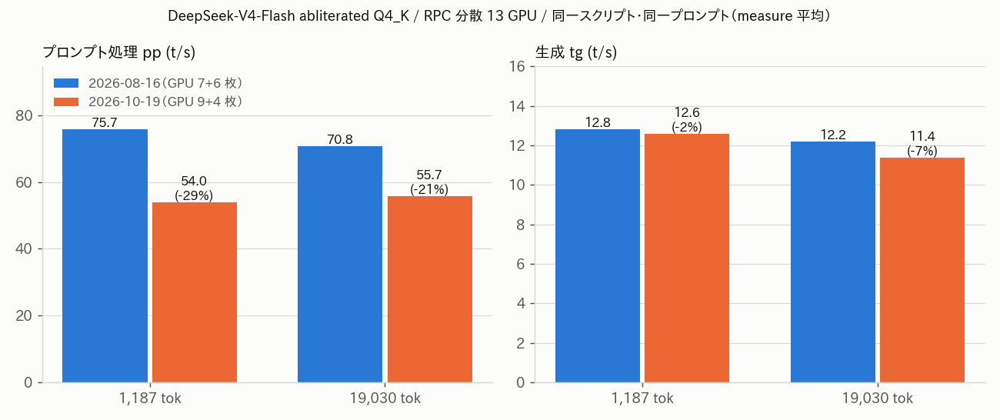

# aws-gpu 2 台の GPU 移設とメモリ再構成 — RPC 分散推論を再開

- **実施日時**: 2026年10月19日 20:00 〜 22:33 JST (aws-gpu01 の 9 枚構成確認、aws-gpu02 の DIMM 再構成を 5 回の起動で確認、100GbE の netplan 修正、RPC 分散の起動と速度計測)
- **報告日時**: 2026年10月19日 22:33 JST
- **作成者**: Claude Opus 5.5 (1M context)

## 概要

aws-gpu02 は 9 月にメモリの故障が重なり、POST で止まって起動しない状態が続いていた。aws-gpu02 が使えないと、2 台をまとめて 1 つの llama-server として動かす既定の RPC 分散構成も動かせず、aws-gpu01 まで実質使えなくなっていた。今回ユーザが現地で GPU とメモリを物理的に入れ替えたので、両機の構成を確かめ、分散推論が再び動くかを試した。

まず、aws-gpu02 から 16GB の P100 を 2 枚抜いて aws-gpu01 に移した。aws-gpu01 は 9 枚認識され、全枚が正常にリンクしていた。新しく入った 2 枚が番号の前のほうに来るため、既存の GPU の番号がすべてずれた。この対応表はスキルのドキュメントに記録した。

aws-gpu02 は、ユーザがメモリの挿し方を変えるたびに電源を入れて構成を確かめた。4 回目でようやく、SPD（DIMM 上の型番情報）が正常に読める Micron の 32GB 3 枚に落ち着いた。途中の構成では、9 月に故障と特定したスロットの DIMM 1 枚だけで OS が動いていたり、型番が読めない DIMM が混じっていたりした。過去のレポートのシリアルと照合すると、型番が読めない 2 枚が以前の故障の当事者で、確定構成からはどちらも外れている。一方、いま使っている 1 枚は 9 月 10 日に POST が故障として名指しした個体だった。今回は問題なく動いているが、ハングが再発したら最初に疑う個体として記録した。確定構成で電源を入れ直し、同じ構成で起動することも確認した。

分散推論の初回起動は失敗した。GPU を挿し直したときに aws-gpu02 の 100GbE カードのスロット位置が変わり、OS 上のネットワーク名が変わっていた。ネットワーク設定は旧名を指定したままだったので、RPC 用のアドレスが付かなかった。設定を「名前ではなくカード固有の MAC アドレスで指定する」形に直したので、今後スロットを変えても外れない。直した後は RDMA で接続され、既定の大型モデルが 13 枚の GPU に収まって応答した。

速度は、8 月の計測と同じスクリプト・同じプロンプトで測り直した。生成速度はほぼ同等だったが、プロンプト処理は 2〜3 割遅くなっていた。ロードの最後に、aws-gpu02 側の 12GB の GPU で計算用バッファが確保できず、llama.cpp が「パイプライン並列なし」に切り替えて起動し直したことがログに残っている。プロンプト処理の低下はこれが原因の可能性が高い。ただし 8 月のログにはこの種のメッセージが出ていないため、まだ断定はできない。計測の途中で一度だけ生成が極端に遅くなったが、ユーザが同時に Web UI から質問を投げていたためと判明したので、計測をやり直している。

次は、プロンプト処理の低下の原因を詰める。12GB の GPU への割り当てを手で減らすか、バッチ設定を見直してパイプライン並列を有効に保てるかを試す。あわせて、名指しされた DIMM の経過観察とメモリ検査、aws-gpu01 側のネットワーク設定も MAC アドレス指定に揃える作業が残っている。

## 添付ファイル

- [実装プラン](attachment/2026-10-19_215846_aws_gpu_card_move_dimm_rebuild_rpc_restart/plan.md)
- 構成スナップショット: [aws-gpu01](attachment/2026-10-19_215846_aws_gpu_card_move_dimm_rebuild_rpc_restart/aws-gpu01_gpu_snapshot.txt) / [aws-gpu02](attachment/2026-10-19_215846_aws_gpu_card_move_dimm_rebuild_rpc_restart/aws-gpu02_gpu_snapshot.txt)（`nvidia-smi` / `topo -m` / `numactl -H`。RPC 稼働中の VRAM 使用量を含む）
- [aws-gpu02 の DIMM 一覧と netplan（新旧）](attachment/2026-10-19_215846_aws_gpu_card_move_dimm_rebuild_rpc_restart/aws-gpu02_memory_network.txt)
- KVM スクショ: [aws-gpu01 の POST](attachment/2026-10-19_215846_aws_gpu_card_move_dimm_rebuild_rpc_restart/kvm_gpu01_post_BA.png) / [aws-gpu02 の `Failing DIMM: P1-DIMMA1`（再構成途中）](attachment/2026-10-19_215846_aws_gpu_card_move_dimm_rebuild_rpc_restart/kvm_gpu02_failing_dimm_p1_dimma1.png) / [aws-gpu02 確定構成の POST](attachment/2026-10-19_215846_aws_gpu_card_move_dimm_rebuild_rpc_restart/kvm_gpu02_final_post_91.png)
- RPC 起動ログ: [1 回目（失敗）](attachment/2026-10-19_215846_aws_gpu_card_move_dimm_rebuild_rpc_restart/rpc_stack_up_1st_failed.log) / [2 回目（成功）](attachment/2026-10-19_215846_aws_gpu_card_move_dimm_rebuild_rpc_restart/rpc_stack_up_2nd_ok.log) / [llama-server ログ](attachment/2026-10-19_215846_aws_gpu_card_move_dimm_rebuild_rpc_restart/llama_server.log) / [rpc-server ログ抜粋](attachment/2026-10-19_215846_aws_gpu_card_move_dimm_rebuild_rpc_restart/rpc_server_log_excerpt.txt)
- 速度計測: [abliterated_speed.csv](attachment/2026-10-19_215846_aws_gpu_card_move_dimm_rebuild_rpc_restart/abliterated_speed.csv) / [ログ](attachment/2026-10-19_215846_aws_gpu_card_move_dimm_rebuild_rpc_restart/bench_speed_abliterated.log) / [UI 干渉で中断した回](attachment/2026-10-19_215846_aws_gpu_card_move_dimm_rebuild_rpc_restart/bench_speed_abliterated_interrupted_by_ui.log)（[csv](attachment/2026-10-19_215846_aws_gpu_card_move_dimm_rebuild_rpc_restart/abliterated_speed_interrupted_by_ui.csv)）
- [図の生成スクリプト mkfig.py](attachment/2026-10-19_215846_aws_gpu_card_move_dimm_rebuild_rpc_restart/mkfig.py)
- 計測スクリプトとプロンプトは 2026-08-16 のものをそのまま使用: [bench_speed.py](attachment/2026-08-16_221024_deepseek_v4_abliterated_comparison/bench_speed.py)

## 核心発見サマリ



**結論**: GPU を **aws-gpu01 9 枚（144GB）+ aws-gpu02 4 枚（56GB）= 13 枚 / 200GB** に組み替えた後も、既定モデル **Huihui-DeepSeek-V4-Flash-0731-abliterated Q4_K（153.3 GiB）を ctx=131072 で RPC 分散起動できた**（RDMA / RoCEv2、ロード約 13 分）。2026-08-16 と同じ `bench_speed.py`・同じプロンプトで、**pp は 75.74→54.00 t/s（1,187 tok、−28.7%）/ 70.77→55.70 t/s（19,030 tok、−21.3%）**、**tg は 12.80→12.58（−1.8%）/ 12.21→11.38 t/s（−6.8%）**。ロード末尾に **`failed to allocate RPC1[192.168.100.2:50052] buffer of size 894887936` → `compute buffer allocation failed, retrying without pipeline parallelism`** が出ており、pp がプロンプト長にほぼ依存しない（54.0 / 55.7 t/s）こととあわせ、**pipeline parallelism が無効になったことが pp 低下の主因と見られる**（8 月のログは同メッセージを出す verbosity でなかったため未確定）。初回起動の失敗は **aws-gpu02 の 100GbE NIC が `01:00.0` に移ってインタフェース名が `enp4s0np0`→`ens1np0` に変わり、netplan が外れた**ため。netplan を **MAC 一致（`50:6b:4b:0b:aa:e2`）**に直して解消した。aws-gpu02 のメモリは **Micron 32GB × 3 = 94 GiB（`P1_DIMMA1`=0FEDE995 / `P2_DIMME1`=0FEDE991 / `P2_DIMMF1`=15CD38B2）で確定**し、2026-09-10 からの起動不能は解消した。

## 前提・目的

- **背景**: aws-gpu02 は `P2_DIMME1`（2026-09-05、uncorrectable ECC）と `P1_DIMMA2`（2026-09-10、POST `No memory DIMM detected` / `BB` で停止）の故障で起動不能だった。RPC 分散が既定の aws-gpu01 も、既定モデルが単体に載らないため実質使えなかった
- **ユーザの物理作業**: aws-gpu02 の P100 16GB 2 枚を aws-gpu01 へ移設、残る GPU と DIMM を差し替え
- **目的**: 両機の構成を確かめて記録し、RPC 分散推論が再び動くかを確認する

## 環境情報

### aws-gpu01（P100 16GB × 9 = 144GB、RAM 157 GiB）

| idx | BDF | Serial | 備考 |
|---|---|---|---|
| 0 | 04:00.0 | 0323818055058 | **aws-gpu02（旧 idx2）から移設** |
| 1 | 05:00.0 | 0320318031972 | 旧 idx0 |
| 2 | 06:00.0 | 0320319086127 | **aws-gpu02（旧 idx1）から移設** |
| 3 | 07:00.0 | 0323818055114 | 旧 idx1 |
| 4 | 08:00.0 | 0323817102181 | 旧 idx2 |
| 5 | 0C:00.0 | 0322818134388 | 旧 idx3 |
| 6 | 0D:00.0 | 0320318067792 | 旧 idx4 |
| 7 | 0E:00.0 | 0320318033253 | 旧 idx5 |
| 8 | 0F:00.0 | 0324218044774 | 旧 idx6 |

全枚 Gen3 x16 / ECC Enabled。GPU0〜4 と GPU5〜8 がそれぞれ別の PCIe スイッチ配下で、全枚 NUMA 0。

### aws-gpu02（P100 16GB × 2 + 12GB × 2 = 56GB、RAM 94 GiB）

| idx | BDF | Serial | VRAM | 備考 |
|---|---|---|---|---|
| 0 | 04:00.0 | 0322818133689 | 16GB | 旧 idx4（88:00.0） |
| 1 | 05:00.0 | 0322718237810 | 12GB | 旧 idx5（89:00.0） |
| 2 | 08:00.0 | 0322718237913 | 12GB | 旧 idx3（84:00.0） |
| 3 | 09:00.0 | 0322818006546 | 16GB | 旧 idx0（05:00.0） |

| スロット | 型番 | Serial | NUMA | 以前の位置 |
|---|---|---|---|---|
| P1_DIMMA1 | Micron 36ASF4G72PZ-2G3A1 | 0FEDE995 | node 0 | 旧 `P1_DIMMA3` |
| P2_DIMME1 | Micron 36ASF4G72PZ-2G3A1 | 0FEDE991 | node 1 | 旧 `P1_DIMMA2`（2026-09-10 に名指し） |
| P2_DIMMF1 | Micron 36ASF4G72PZ-2G3D1 | 15CD38B2 | node 1 | 旧 `P2_DIMME2`（当時はアドレスマップ外） |

3 枚とも 2133 MT/s。

### ソフトウェア

- llama.cpp: 両機とも `465e49b9cea78a68b9c244ffb48d0ee24a82873d`（一致）
- 起動: `llama-up.sh aws-gpu01`（→ `rpc-stack-up.sh`）、既定パラメータ `--n-gpu-layers 999 --flash-attn 1 --poll 0 -b 2048 -ub 512 --jinja`、ctx=131072

## 結果詳細

### (a) aws-gpu01 の 9 枚構成

ユーザの指示で電源を投入し（`ALLOW_FAN_NOISE=1 bmc-power.sh aws-gpu01 on`）、約 2.5 分の POST の後に OS が起動した。9 枚とも認識され、uncorrectable ECC 0、retired pages の pending なし。ドキュメントは commit `8cf7f51d` で 9 枚構成に更新した。

### (b) aws-gpu02 の DIMM 再構成の推移

| 回 | OS から見える DIMM | 容量 | 所見 |
|---|---|---|---|
| 1 | `P2_DIMME1`（`<BAD INDEX>`）のみ | 31 GiB | POST に `Failing DIMM: P1-DIMMA1 (Uncorrectable memory component found)`（コード B7）。9/5 の故障スロットの DIMM 1 枚だけで OS が動いていた |
| 2 | E1（`<BAD INDEX>`）/ E2 / E3 / F1 | 125 GiB | チャネル E に 3 枚で 1600 MT/s に低下。node 0 は 0 MB |
| 3 | F1 / F2（`<BAD INDEX>`） | 62 GiB | Redfish でも 2 枚のみ。node 0 は 0 MB |
| 4（確定） | A1 / E1 / F1（全て Micron） | 94 GiB | 2133 MT/s、node 0 に 32 GB |
| 5（再起動確認） | 同上 | 94 GiB | 同一構成で起動 |

- 全回とも EDAC の CE/UE は 0、MCE なし、SEL の `Uncorrectable ECC` は 11 件（2026-09-05 以前の分）から増えていない
- **シリアル照合**（2026-09-05 の dmidecode / Redfish 添付と比較）: `<BAD INDEX>` の DIMM は旧 `P1_DIMMA1`（Kingston）と旧 `P2_DIMME1`（9/5 の故障個体）の 2 枚で、Redfish のシリアルが `\x14#…` に化けて区別できない。確定構成からはどちらも外れた
- **`0FEDE991` は 2026-09-10 の `No memory DIMM detected / P1-DIMMA2` で名指しされた個体**で、9/5 の Redfish でも `Health: Critical` だった。今回は正常に動いている
- ドキュメントは commit `1981dcf2` で更新した（CLAUDE.md の「起動しない」「故障 DIMM」節を解消済みに統合）

### (c) RPC 初回起動の失敗と netplan 修正

`rpc-up.sh` が `ERROR: 192.168.100.2:50052 が LISTEN しませんでした` で失敗した。ワーカーのログは `Failed to create server socket`。

| | 以前 | 今回 |
|---|---|---|
| NIC の BDF | 04:00.0 | **01:00.0**（GPU にスロットを譲った） |
| インタフェース名 | `enp4s0np0` | **`ens1np0`**（altname `enp1s0np0`） |
| netplan の指定 | 名前 `enp4s0np0` | → **`match: macaddress: 50:6b:4b:0b:aa:e2`** に変更 |

ケーブルは生きており、`ip link set up` で即座に 100G / DAC でリンクした。aws-gpu02 の `/etc/netplan/60-rpc-100gbe.yaml` を MAC 一致に書き換え（旧ファイルは `.bak-20261019`）、`netplan apply` で `192.168.100.2/24`・MTU 9000 が付き、aws-gpu01（192.168.100.1）へ ping が通った。aws-gpu01 側は名前（`enp11s0np0`）が変わっておらず手を入れていない。

### (d) RPC 分散の起動と速度

- RDMA: ワーカー側に `RDMA probed: dev=mlx5_0 gid=3 RoCEv2` / `RDMA activated` が出た
- ロード: 約 13 分（`listening on` まで 11 分 58 秒 + 待機）
- **ロード末尾のログ**:
  ```
  E ggml_gallocr_reserve_n_impl: failed to allocate RPC1[192.168.100.2:50052] buffer of size 894887936
  E graph_reserve: failed to allocate compute buffers
  W sched_reserve: compute buffer allocation failed, retrying without pipeline parallelism
  ```
- 稼働中の空き VRAM: aws-gpu01 は 756〜7,656 MiB、aws-gpu02 は **CUDA1（12GB）が 285 MiB** で最少

速度（`bench_speed.py`、`/completion`、`cache_prompt: false`、`n_predict 128`、greedy）:

| 条件 | 2026-08-16（7+6 枚） | 2026-10-19（9+4 枚） | 差 |
|---|---|---|---|
| pp @1,187 tok（N=3） | 75.74 t/s | 54.00 t/s | **−28.7%** |
| tg @1,187 tok（N=3） | 12.80 t/s | 12.58 t/s | −1.8% |
| pp @19,030 tok（N=2） | 70.77 t/s | 55.70 t/s | **−21.3%** |
| tg @19,030 tok（N=2） | 12.21 t/s | 11.38 t/s | −6.8% |

各回のばらつきは pp ±0.04 t/s 以内と小さい。8 月は pp が長文で下がっていた（75.7→70.8）。今回はプロンプト長にほぼ依存せず 54〜56 t/s で頭打ちになっている。プロンプト処理のマイクロバッチが段ごとに重ならず直列に流れている挙動と整合し、pipeline parallelism の無効化を裏付ける。

参考として、chat API で事前に測った値（thinking 無効）: 19 tok で tg 10.9 t/s、10,410 tok で pp 55.5 / 57.2 t/s・tg 11.6 / 11.9 t/s。

## 副次発見

- **計測中の外れ値は Web UI からのリクエストとの重なりだった**: 1 回目の計測で pp1k measure#2 の tg が 1.96 t/s（wall 86.8 秒）に落ちた。ユーザが同時に llama-server の Web UI からプロンプトを投げていたためで、UI を止めてやり直した計測では tg 12.57〜12.58 t/s で安定した。中断した回のログと csv は `*_interrupted_by_ui.*` として残してある。共有エンドポイントで計測するときは、`/slots` が全スロット idle であることを確認してから始めるとよい
- **Bash サンドボックスからだけ 10.8.2.x に届かない**: aws-gpu01/02 への SSH・ping がサンドボックス内では `No route to host` になり、`dangerouslyDisableSandbox` で通った（`lock-status.sh` は全サーバ UNREACHABLE と表示）
- **待機の完了通知が実状態より先に届く**: Monitor やバックグラウンドタスクの完了通知（`READY` / `OFF` / exit 0）が、実際にはまだ POST 中・電源 On・スクリプト実行中の時点で届くことが複数回あった。電源状態や起動完了は BMC / SSH / ログ末尾で直接確かめて判定した
- **aws-gpu02 の POST は確定構成で約 1 分 20 秒**: 電源投入から SSH 応答まで。メモリ故障があった回は表示を伴って長引いた

## 残課題

- **pp 低下の切り分け**: pipeline parallelism を有効に保てるかを試す。候補は `--tensor-split` で aws-gpu02 の 12GB 枚（RPC1）への割り当てを減らす、または `-b` / `-ub` の調整。`-lv 4` で `pipeline parallelism enabled` が出るかを確認する
- **`0FEDE991` の経過観察**: 9/10 に名指しされた個体なので、ハングや ECC が出たら最初に疑う。使い始める前に memtest で検査するのが望ましい
- **aws-gpu01 の netplan も MAC 一致にする**: 今回は名前が変わらなかったが、同じ事故を防ぐため（aws-gpu01 の sudo はユーザ依頼）
- **`Patrol Scrub` を Enable に戻す**: 故障 DIMM を抜いたので回避策としては不要（BIOS setup に入る機会に）
- **llama-server / rpc-server は稼働中、両機のロックを保持中**（停止は別途指示を待つ）

## 参照レポート

- [RPC 分散で DeepSeek-V4-Flash を 2 台に載せる](./2026-08-16_175749_deepseek_v4_rpc_dual_gpu_server.md)
- [abliterated 版との比較（今回の速度比較の基準値）](./2026-08-16_221024_deepseek_v4_abliterated_comparison.md)
- [aws-gpu02 の uncorrectable ECC（`P2_DIMME1`）](./2026-09-05_221831_aws_gpu02_uncorrectable_ecc.md)
- [aws-gpu02 の `P1_DIMMA2` 故障で起動不能](./2026-09-11_055337_aws_gpu02_dimma2_failure_glm53flash_upstream.md)
- [aws-gpu01 の ECC 有効化](./2026-09-24_211644_aws_gpu01_ecc_enable.md)
